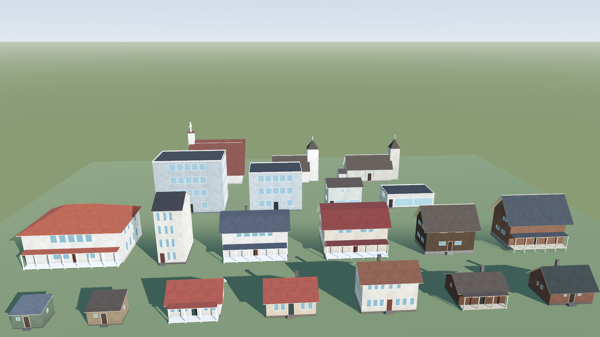
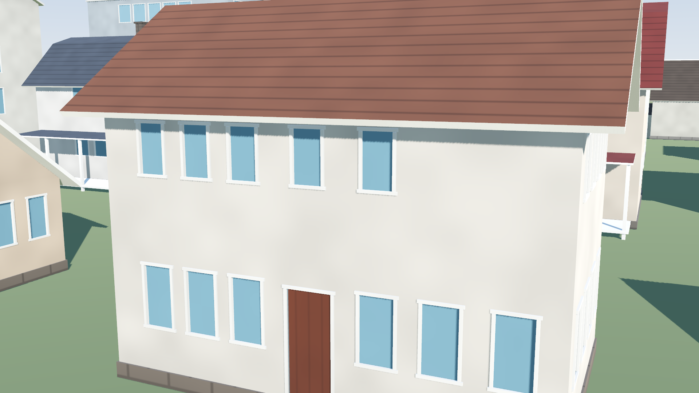
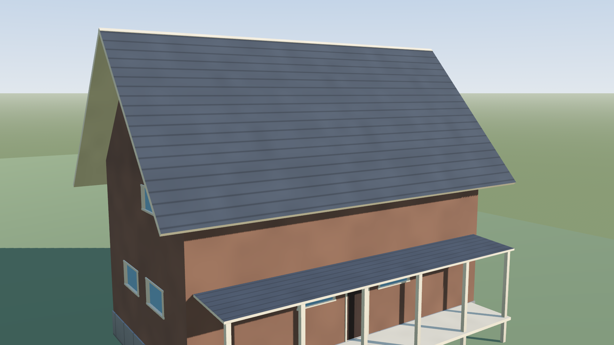
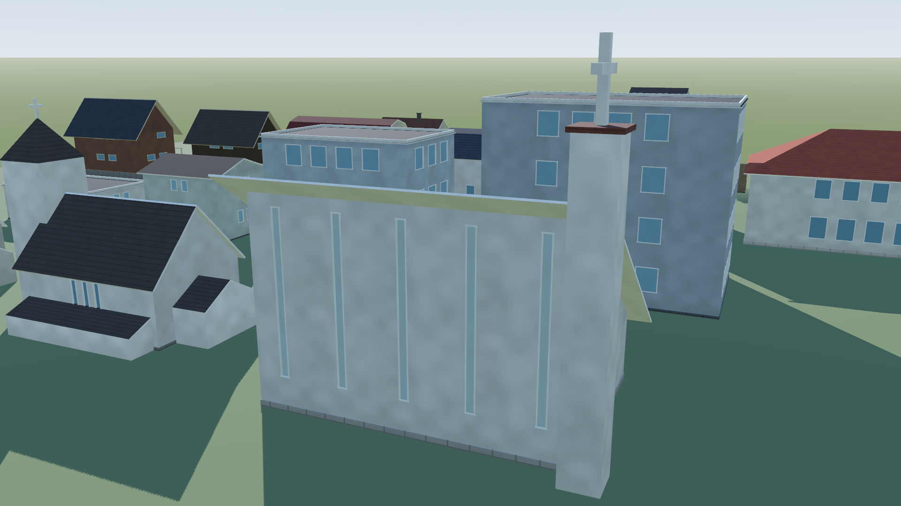

# House Generator

Godot 4.7 editor plugin that builds houses, shops, offices, and churches from a property resource and bakes them into meshes you can scatter by hand or with [Terrain3D](https://github.com/TokisanGames/Terrain3D).



The mesh origin is the ground contact at the footprint center. The front faces -Z. Width runs along X, depth along Z. Each baked scene is one mesh per level of detail. The near mesh keeps separate materials for walls, roof, trim, foundation, door, glass, and chimney. The far mesh keeps walls and roof, so Terrain3D can instance it across a large scenery.

Licensed under the [MIT License](LICENSE).

## Examples



A cottage. Upper windows are shorter than the ground floor, and the door keeps a pier of wall beside it.



A chalet, with a low eave and a porch.



A 1960s church. The tall wall is a row of slits, and the campanile carries a cross whose size follows the seed. The chapel behind it is the older plan: a west tower, a nave, and a smaller cross.

Run the project to walk around `demo/village.tscn`. It contains every building type.

## Install

Requires Godot 4.7.

1. Copy `addons/house_generator` into your project's `addons` folder.
2. Enable **House Generator** in Project Settings → Plugins.
3. Add a `GeneratedHouse` node, or open the **Houses** dock.

`demo/village.tscn` is a ready-made scene of one example of each style. `house_catalog` is a baked set of repeated buildings for scattering.

## One house

1. Add a `GeneratedHouse` node.
2. Edit its `properties` resource: style, size, floors, roof, porch, colors.
3. Use **Randomize** in the inspector to reroll that style.

**Seed** changes which windows are omitted and adds a slight wall tint. Door side, chimney side, and which walls have windows are separate fields. **Window pattern** and **variation** change how the base window size is distributed: smaller upstairs, wider upstairs, a wider center bay, an alternating rhythm, or a mirrored irregular row. Variation at 0 keeps every window the same size. The size and the base colors stay as they are.

Styles:

| Style | Character |
| --- | --- |
| Cabin | Small, nearly square windows |
| Cottage | Upright casements, smaller upstairs |
| Townhouse | Tall sashes, door to one side |
| Farmhouse | Wide windows, wider in the center |
| Villa | Large ground-floor windows |
| Shed | One small window |
| Chalet | Horizontal windows, wider upstairs |
| Shop | Glazed shop front, rooms above |
| Office | Regular grid of large panes |
| Church | Chapel with a west tower, the same chapel with a side aisle, or a 1960s hall |

The church plan comes from the seed.

## A batch of scenes

Open the **Houses** dock.

- **Generate scenes** writes `LOD0`, `LOD1`, and `LOD2` scenes into `res://generated_houses`.
- **Place one in the open scene** adds an editable `GeneratedHouse`.
- **Bake selected house** writes the selected node's current properties to a scene file.
- **Bake catalog** writes the repeated set in `res://house_catalog`.

`HouseScatter` places houses inside the current scene. Set the area, spacing, and styles, then press **Scatter houses**. Those nodes stay editable. For many copies of one design, bake a few variants and instance those.

```gdscript
var props := HouseProperties.make(HouseProperties.Style.FARMHOUSE, 42)
props.width = 12.0
var mesh := HouseGenerator.build_mesh(props)
HouseGenerator.save_scatter_scene(props, "res://generated_houses/farmhouse_42.tscn")

HouseGenerator.scatter(some_node, {
	"count": 6,
	"seed": 3,
	"area": Vector2(40, 40),
	"styles": [HouseProperties.Style.COTTAGE, HouseProperties.Style.CABIN],
	"min_spacing": 9.0,
})
```

## Terrain3D

1. Generate a few variant scenes. Each variant is one mesh asset. Terrain3D cannot combine different houses into one MultiMesh.
2. In the Terrain3D asset dock, add a mesh and set **Scene File** to the `.tscn`.
3. The scene's `LOD0`, `LOD1`, and `LOD2` nodes are picked up as levels of detail. For a large scenery, set the ranges to about 250 m, 800 m, and 2,000 m, and cast shadows from `LOD0` only. Set `lod0_range` to `0` if you want Godot's automatic LOD instead.
4. Paint with the foliage tool, or place from code:

```gdscript
var transforms: Array[Transform3D] = []
transforms.append(HouseGenerator.upright_on_ground(terrain, Vector3(x, 0, z), rotation, props.width, props.depth))
terrain.instancer.add_transforms(mesh_id, transforms)
```

`upright_on_ground` keeps the house vertical and sets the origin to the lowest collision under the foundation, so the downhill side meets the slope and the uphill side sits in the ground. Paint tools that align instances to the terrain normal will tilt houses; leave that alignment off for buildings.

Porch posts are spaced about 2.4 m apart. On a `GeneratedHouse`, each post is extended down to the scenery under it. Editor bakes end the posts at the origin. Catalog meshes continue the foundation and the porch posts 1.5 m below the origin.

`mesh_id` is the id of the mesh asset you added. Call `update_mmis()` after a batch if you pass `update` as false.

## Catalog

Terrain3D has 32 mesh slots. Vegetation already uses some of them, so a scenery wants a small set of repeated buildings rather than one mesh per building. **Bake catalog** writes `res://house_catalog`. The set is cabin, cottage, farmhouse, shed, and chalet, plus a shop with a glazed front, a flat-roofed office, and three churches. Townhouses and villas stay out. Each file is a thin scene whose children are `LOD0`, `LOD1`, and `LOD2`, pointing at external meshes. There is no house script on those scenes, so another project can load them without this addon. Shadows are on `LOD0` only. `LOD1` is the approach mesh. `LOD2` is the far mesh.

Wall and roof colors are vertex colors on one shared material, so Terrain3D's instance tint can shift copies of one asset. The same material samples a tiled grain per surface (plaster, tile, stone, glass) and a matching roughness. Vertex color darkens the ground line, the corners, and the underside of the eaves. The near catalog mesh also uses fewer windows and skips the window frames.

```gdscript
HouseCatalog.save_catalog("res://house_catalog")

var fit := HouseCatalog.fit_footprint(footprint_points, osm_tags, [], height_image, height_origin, spacing_m)
if fit.ok:
    var placed := Transform3D(Basis(Vector3.UP, fit.yaw), fit.position)
    terrain.instancer.add_transforms(mesh_id_for(fit.scene), [placed])
```

`fit_footprint` returns the footprint width, depth, and yaw, plus the closest catalog variant. Yaw follows the long edge, and the front stays on local -Z. The mesh is not stretched. A `building=church` outline uses a church, `office` uses an office, and `retail` or `shop` uses a shop. Other outlines stay on the house variants, so a cottage is not replaced by an office of a similar size. Courtyards, terraces, building parts, and large halls come back as a rejection (`ok` false, with a `reason`) and should stay on the extruded OSM mesh.

`ground_on_heightmap` reads the height image the same way scenery generation does. The house stays upright. Its origin sits on the lowest sample under the foundation. If the height change is greater than that variant's foundation, the uphill floor would be buried and the fit is rejected. The same happens when the porch drops more than the 1.5 m skirt.

## License

[MIT](LICENSE).
